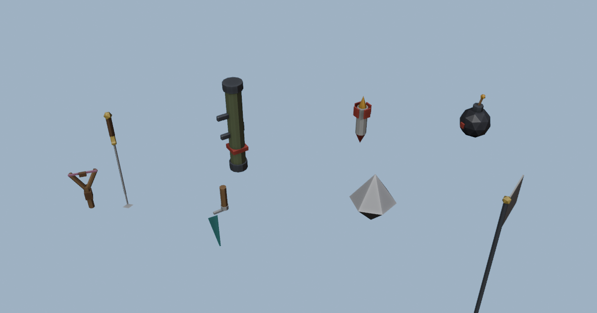

# Brickfall: Skyhold

A serverless, peer-to-peer brick-battle game for the browser. Four teams, four floating
islands, fully destructible brick castles. Knock an enemy team's **Core** off its tower
and they can't respawn. Last team standing wins.



## Highlights

- **No servers.** Peers find each other through public Nostr relays (via
  [Trystero](https://github.com/dmotz/trystero)), then talk directly over WebRTC.
  Hosting is just static files (GitHub Pages).
- **Host election without negotiation.** The oldest peer in a room simulates brick physics.
  If it leaves, the next oldest takes over using the world state it already mirrors.
  Newcomers can't take over an existing room, even when their clock is wrong.
- **Real destruction.** [Rapier](https://rapier.rs) physics. Bricks are welded until a blast
  frees them, then a flood fill drops anything that's lost its support.
- **Two renderers.**
  - WebGL (1 or 2): every brick is drawn in one instanced call; studs, outlines and rock
    are procedural shaders, with no textures at all.
  - CPU fallback: a software rasteriser for machines without a usable GPU. It skips faces
    hidden by neighbouring bricks (about 46% of them), culls per box, uses flat shading,
    and dithers transparency.
- **Built for low-end devices.** Dynamic resolution, quality presets chosen from the
  device's hardware, a 10 KB menu with the game streamed in behind it, and physics
  WebAssembly that's streamed and compiled as it downloads.
- **Touch controls** on phones and tablets.
- **Models made in Blender:** `tools/blender/build_assets.py` builds and exports every tool mesh.

## Controls

| | |
|---|---|
| WASD / Space | move / jump |
| Mouse / Click | aim / use tool |
| 1-5 | Sword, Rocket, Bomb, Slingshot, Builder |
| Wheel or I / O | zoom (all the way in = first person) |
| T / Tab / Enter / Esc | team, scoreboard, chat, menu |

## Develop

```sh
npm install
npm run dev        # http://localhost:5173
npm run build      # static site in dist/
npm run assets     # rebuild models with Blender (headless)
npx tsx tests/protocol-check.ts   # multiplayer protocol test (in-process peers)
```

## Deploy

Push to `main` on GitHub. `.github/workflows/deploy.yml` runs the tests, builds the site,
and publishes it to GitHub Pages. One-time setup: **Settings → Pages → Source: GitHub Actions**.

## Networking notes

- Share a room with the invite link (`#room=...`). **Quick play** joins `public-1`.
- Strict networks (school or corporate Wi-Fi, symmetric NAT) can block direct WebRTC.
  Add a TURN server via the URL: `?turn=turn:host:3478&turnUser=u&turnPass=p`. You can
  also add signalling relays: `?relay=wss://your.relay`.
- Trust model: casual. Each player is authoritative over their own movement and health,
  and the host is authoritative over bricks and rounds.
